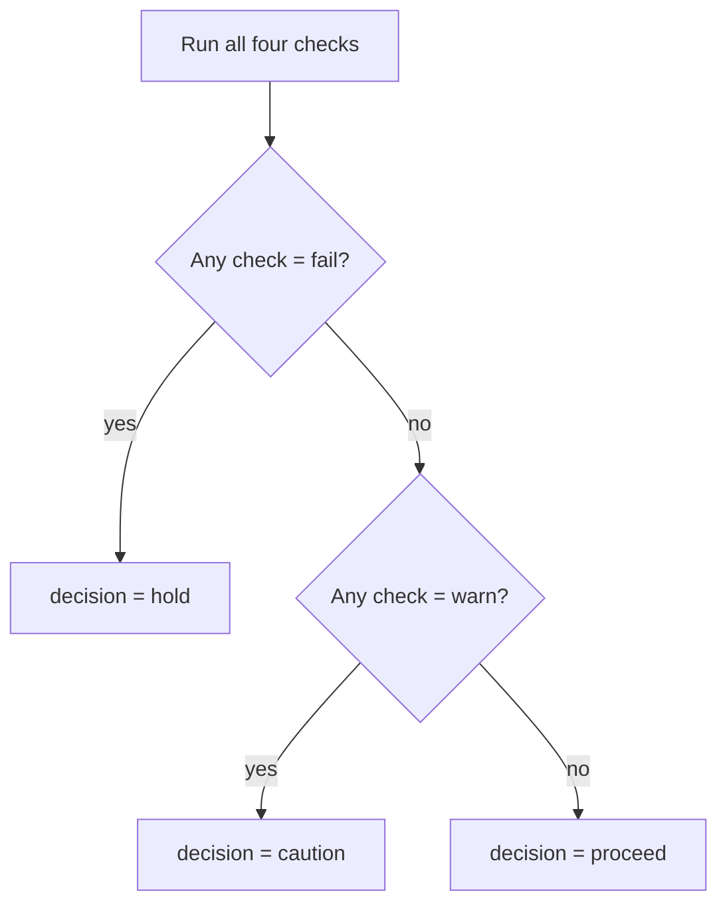

# Preflight decision model

> Closes #2633. Source of truth for all numbers and thresholds is
> [`backend/src/api/preflight.rs`](../backend/src/api/preflight.rs).
> Every constant listed here is a `pub const` in that file so that doc numbers
> always match the running code.

The `/api/v1/preflight` endpoint answers one question before money moves: *is
this corridor healthy enough to pay on right now?*  It runs four independent
checks, each producing **pass / warn / fail**, then combines them into a single
**decision**.

---

## Decisions

| Decision | Meaning | Recommended action |
|---|---|---|
| `proceed` | Every check passed | Send the payment |
| `caution` | At least one check is marginal | Send with care, or use an alternative corridor |
| `hold` | At least one check failed | Do not pay on this corridor now |
| `unknown` | No recent payments observed | No recommendation; apply your own policy |

`unknown` is not a failure — it means the corridor has no recent payment
history on the Stellar ledger.  Apply your own policy (e.g. treat it as
`caution`, or fall back to a known-good corridor).

---

## How the decision is derived from checks



The four checks are independent: every one runs regardless of the others.  The
worst individual outcome sets the decision.

---

## The four checks

### 1. `success_rate`

Measures the percentage of recent payments on the corridor that settled
successfully.

| Status | Condition |
|---|---|
| `pass` | success rate ≥ `min_success_rate` (default **95 %**) |
| `warn` | success rate is within **10 percentage points** below `min_success_rate` |
| `fail` | success rate is more than 10 points below `min_success_rate` |

The caller may override `min_success_rate` per request (clamped to safe
bounds).  The default (`DEFAULT_MIN_SUCCESS_RATE = 95.0`) and the warn margin
(`WARN_MARGIN_SUCCESS_RATE = 10.0`) are defined in `preflight.rs`.

> **Stellar context.** The Stellar payment stream only records settlements, so
> the success rate in PayRaider reflects corridor-level factors (anchor
> availability, liquidity, compliance holds) rather than individual transaction
> errors. See [SEP-31](https://github.com/stellar/stellar-protocol/blob/master/ecosystem/sep-0031.md)
> for the cross-border payment standard that anchors implement.

### 2. `liquidity`

Compares the requested `amount_usd` against the corridor's observed liquidity
depth.  Skipped (no status emitted) when `amount_usd` is omitted.

| Status | Condition |
|---|---|
| `pass` | payment ≤ **10 %** of observed liquidity (`COMFORTABLE_LIQUIDITY_SHARE = 0.10`) |
| `warn` | payment is between 10 % and **50 %** of observed liquidity (`MAX_LIQUIDITY_SHARE = 0.50`) |
| `fail` | payment > 50 % of observed liquidity, or observed liquidity is zero |

### 3. `sample_size`

Checks that there are enough recent payments for the other metrics to be
statistically meaningful.

| Status | Condition |
|---|---|
| `pass` | at least **20** recent payments observed (`MIN_SAMPLE_SIZE = 20`) |
| `warn` | fewer than 20 payments |
| `fail` | *never fails* — low sample size can only warn |

### 4. `health_score`

A composite 0–100 score aggregated from corridor metadata (success rate,
latency, liquidity depth, recent volume).  Higher is healthier.

| Status | Condition |
|---|---|
| `pass` | score ≥ **80** |
| `warn` | score ≥ **60** but < 80 |
| `fail` | score < 60 |

---

## Example: full response

```json
{
  "decision": "hold",
  "summary": "Failed on: liquidity. Do not pay on this corridor right now.",
  "score": 83.0,
  "corridor": {
    "id": "USDC:G...->NGN:G...",
    "success_rate": 97.0,
    "liquidity_depth_usd": 166600.0
  },
  "checks": [
    { "name": "success_rate", "status": "pass",  "detail": "100.0% of recent payments succeeded (minimum 95.0%)" },
    { "name": "liquidity",    "status": "fail",  "detail": "payment is 60.0% of $166600 observed liquidity" },
    { "name": "sample_size",  "status": "pass",  "detail": "33 recent payments observed (at least 20 for confidence)" },
    { "name": "health_score", "status": "pass",  "detail": "corridor health score 83.0 of 100" }
  ],
  "alternatives": [],
  "evaluated_at": "2026-01-01T00:00:00+00:00"
}
```

Even though three of the four checks passed, the `liquidity` check failed, so
the decision is `hold`.

---

## Constant reference

All thresholds are `pub const` values in
[`backend/src/api/preflight.rs`](../backend/src/api/preflight.rs):

| Constant | Value | Used by |
|---|---|---|
| `DEFAULT_MIN_SUCCESS_RATE` | `95.0` | `success_rate` check default |
| `WARN_MARGIN_SUCCESS_RATE` | `10.0` | `success_rate` warn band |
| `COMFORTABLE_LIQUIDITY_SHARE` | `0.10` | `liquidity` pass threshold |
| `MAX_LIQUIDITY_SHARE` | `0.50` | `liquidity` warn/fail boundary |
| `MIN_SAMPLE_SIZE` | `20` | `sample_size` pass threshold |
| `MAX_ALTERNATIVES` | `3` | max alternative corridors returned |

The `health_score` thresholds (60 / 80) live inline in the `run_checks`
function in the same file.

---

## See also

- [Integration guide](INTEGRATION_GUIDE.md) — how to act on each decision in
  your off-ramp or payout app
- [PLUGIN.md](PLUGIN.md) — REST, SDK, MCP server and Claude plugin usage
- [OpenAPI spec](openapi.json) — machine-readable schema for all request and
  response types
