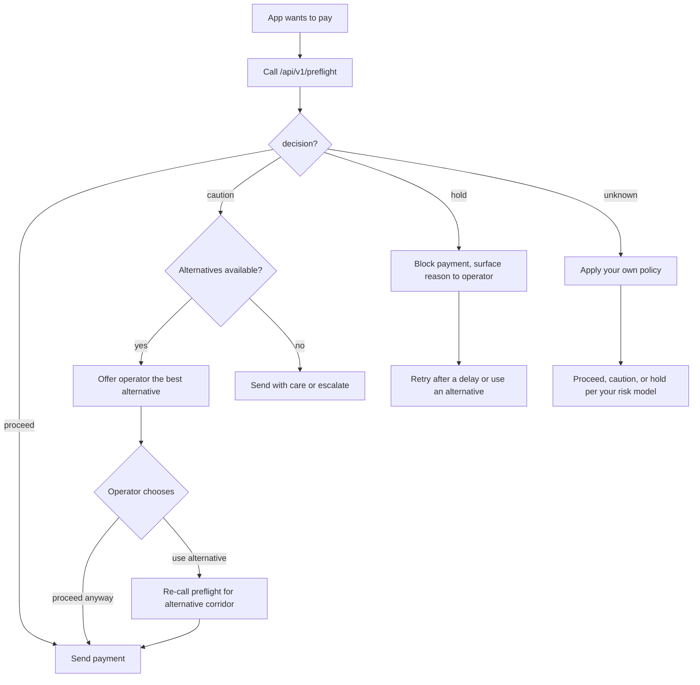

# Off-ramp / payout integration guide

> Closes #2632.  Start here if you are wiring PayRaider into a payout
> application.  For the full SDK and plugin reference see
> [PLUGIN.md](PLUGIN.md).  For the numbers behind each check see
> [DECISION_MODEL.md](DECISION_MODEL.md).

---

## Overview

PayRaider exposes a single pre-payment check endpoint:

```
GET /api/v1/preflight?source_asset=USDC&destination_asset=NGN&amount_usd=2500
```

Call it **before** every outbound payment.  It returns one of four decisions —
`proceed`, `caution`, `hold`, or `unknown` — plus the individual checks that
produced it and up to three healthier alternative corridors.

The endpoint is **public and read-only**.  No API key is required to evaluate
it; an API key only raises the anonymous rate-limit.

---

## Integration flow



---

## Step 1 — Call the endpoint

Both a `GET` with query parameters and a `POST` with a JSON body are
supported.

**GET (simplest)**

```bash
curl -s "https://<your-payraider-host>/api/v1/preflight?source_asset=USDC&destination_asset=NGN&amount_usd=2500"
```

**POST (preferred when amount may contain special characters)**

```bash
curl -s -X POST "https://<your-payraider-host>/api/v1/preflight" \
  -H "Content-Type: application/json" \
  -d '{"source_asset":"USDC","destination_asset":"NGN","amount_usd":2500}'
```

**Request parameters**

| Parameter | Required | Description |
|---|---|---|
| `source_asset` | yes | Asset sent by the payer: `USDC` or `USDC:GA5ZSEJ...` |
| `destination_asset` | yes | Asset received by the payee: `NGN` or `NGN:GB4...` |
| `amount_usd` | no | Payment size in USD equivalent; omit to skip the liquidity check |
| `min_success_rate` | no | Override the success-rate threshold (default 95 %) |

Asset codes match case-insensitively.  If multiple issuers serve the same
code pair, the healthiest corridor is evaluated.  Supply `CODE:ISSUER` to pin
a specific issuer.

> **Stellar assets.** Every asset on Stellar is identified by a 1–12 character
> code and an issuer account (`G...`). Native XLM is `XLM` (no issuer). See
> the [Stellar docs on assets](https://developers.stellar.org/docs/learn/fundamentals/stellar-data-structures/assets)
> for more detail.

---

## Step 2 — Act on the decision

### `proceed`

Every check passed.  Send the payment.

```typescript
if (check.decision === "proceed") {
  await sendPayment(corridor);
}
```

### `caution`

At least one check is marginal.  The payment will probably work but there is
elevated risk.  Best practice:

1. Log the check details and the corridor ID for post-payment reconciliation.
2. If alternatives are present, offer the operator the best one.
3. If the operator wants to proceed anyway, send with an audit trail.

```typescript
if (check.decision === "caution") {
  if (check.alternatives.length > 0) {
    const best = check.alternatives[0];
    const altCheck = await client.preflight.check({
      source_asset: best.source_asset,
      destination_asset: best.destination_asset,
      amount_usd: params.amount_usd,
    });
    if (altCheck.decision === "proceed") {
      await sendPayment(best);
      return;
    }
  }
  // No better alternative; log and send with caution.
  logger.warn("Sending on caution corridor", { corridor: check.corridor, checks: check.checks });
  await sendPayment(corridor);
}
```

### `hold`

At least one check failed.  **Do not send the payment.**

Surface the `summary` field to the operator and the `checks` array so they
can see which check failed and why.  Retry after a delay, or route to an
alternative corridor.

```typescript
if (check.decision === "hold") {
  throw new PaymentHeldError(check.summary, {
    failedChecks: check.checks.filter(c => c.status === "fail"),
    alternatives: check.alternatives,
  });
}
```

### `unknown`

No recent payment history for this corridor.  PayRaider makes no
recommendation.  Apply your own policy based on your risk tolerance:

```typescript
if (check.decision === "unknown") {
  // Example policy: treat unknown as caution for amounts below $500,
  // block above that.
  if (params.amount_usd && params.amount_usd > 500) {
    throw new Error("No corridor data; blocking payment above $500");
  }
  logger.info("No corridor data; proceeding with caution", { corridor: params });
  await sendPayment(corridor);
}
```

---

## Step 3 — Retries and alternatives

When a decision is `hold` or `caution`, `alternatives` lists up to three
healthier corridors to the same destination asset, ordered by health score
(best first).

```json
"alternatives": [
  { "id": "USDC:GA5Z...->NGN:GB4Z...", "success_rate": 99.1, "health_score": 92.0 },
  { "id": "USDC:G3AB...->NGN:GB4Z...", "success_rate": 96.5, "health_score": 85.0 }
]
```

Re-call `/preflight` for each alternative before using it — its state may have
changed since the original response.

**Recommended retry strategy**

| Decision | Action | Retry interval |
|---|---|---|
| `hold` | Switch to best alternative; if none, wait and retry | ≥ 60 s |
| `caution` | Proceed or switch to best `proceed` alternative | Immediate |
| `unknown` | Apply your policy; no benefit from retrying quickly | ≥ 5 min |

---

## Step 4 — Using an API key (optional)

The anonymous tier is shared per IP.  An API key gives your application its
own rate-limit bucket (200 req/min by default; 1 000 req/min on the Pro plan).

Keys are tied to a Stellar wallet via
[SEP-10](https://github.com/stellar/stellar-protocol/blob/master/ecosystem/sep-0010.md)
(the Stellar authentication standard):

```bash
# 1. Request a challenge
curl -s -X POST https://<host>/api/sep10/auth \
  -H 'Content-Type: application/json' \
  -d '{"account":"G<your-wallet-pubkey>"}'
# → {"transaction":"<challenge-XDR>"}

# 2. Sign the challenge with your wallet key and send it back
curl -s -X POST https://<host>/api/sep10/verify \
  -H 'Content-Type: application/json' \
  -d '{"transaction":"<challenge-XDR>","signature":"<base64-ed25519-sig>"}'
# → {"token":"<session-JWT>"}

# 3. Create a named API key
curl -s -X POST https://<host>/api/api-keys \
  -H 'Authorization: Bearer <session-JWT>' \
  -H 'Content-Type: application/json' \
  -d '{"name":"my-offramp"}'
# → {"plain_key":"si_live_..."}   ← shown once; store it securely

# 4. Use the key
curl -s "https://<host>/api/v1/preflight?source_asset=USDC&destination_asset=NGN&amount_usd=2500" \
  -H 'Authorization: Bearer si_live_...'
```

Set `PAYRAIDER_API_KEY` in the environment and the TypeScript / Python SDKs
will pick it up automatically.

---

## TypeScript SDK quick start

```bash
npm install @payraider/sdk
```

```typescript
import { PayRaider } from "@payraider/sdk";

const client = new PayRaider({
  baseUrl: process.env.PAYRAIDER_BASE_URL,
  apiKey: process.env.PAYRAIDER_API_KEY,   // optional
});

async function safelyPay(source: string, dest: string, amountUsd: number) {
  const check = await client.preflight.check({
    source_asset: source,
    destination_asset: dest,
    amount_usd: amountUsd,
  });

  switch (check.decision) {
    case "proceed":
      return sendPayment(source, dest, amountUsd);

    case "caution":
      console.warn("Caution:", check.summary, check.checks);
      return sendPayment(source, dest, amountUsd);

    case "hold":
      throw new Error(`Payment blocked: ${check.summary}`);

    case "unknown":
      // Apply your risk policy here.
      throw new Error("No corridor data; not sending");
  }
}
```

---

## Python SDK quick start

```bash
pip install payraider
```

```python
import asyncio, os
from payraider import PayRaider

async def safe_pay(source: str, dest: str, amount_usd: float):
    async with PayRaider(
        base_url=os.environ["PAYRAIDER_BASE_URL"],
        api_key=os.environ.get("PAYRAIDER_API_KEY"),
    ) as client:
        check = await client.preflight.check(source, dest, amount_usd=amount_usd)

        if check["decision"] == "proceed":
            await send_payment(source, dest, amount_usd)
        elif check["decision"] == "hold":
            raise RuntimeError(f"Payment blocked: {check['summary']}")
        else:
            # caution or unknown — apply your own policy
            print(f"Proceeding on {check['decision']}: {check['summary']}")
            await send_payment(source, dest, amount_usd)
```

---

## Error handling

Invalid input returns HTTP 400 with a standard error shape:

```json
{ "error": "amount_usd must be positive" }
```

Common validation errors:

| Input error | HTTP status |
|---|---|
| Missing `source_asset` or `destination_asset` | 400 |
| Non-positive `amount_usd` | 400 |
| `min_success_rate` outside 0–100 | 400 |

Network errors, 5xx responses, and rate-limit (429) responses should be
retried with exponential back-off.  The preflight check is read-only; retrying
is safe.

---

## See also

- [Decision model](DECISION_MODEL.md) — full threshold reference and how
  checks combine into a decision
- [PLUGIN.md](PLUGIN.md) — MCP server, Claude plugin, and USDC billing
- [OpenAPI spec](openapi.json) — machine-readable schema; also served live at
  `/api-docs` on a running backend
- [Snapshot anchoring](SNAPSHOT_ANCHORING.md) — verify that published
  metrics match the hash anchored on Stellar
  (`GET /api/v1/snapshots/{id}/verify`)
