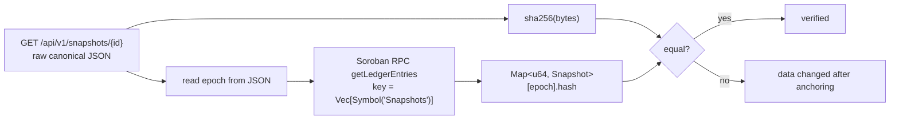

# Snapshot anchoring and verification

PayRaider publishes corridor and anchor reliability numbers. On their own those
numbers are just claims. To make them checkable, the backend periodically
freezes its metrics into an **analytics snapshot**, hashes it, and writes the
hash to the `payraider` smart contract on Stellar. Anyone can later download
the snapshot, hash it themselves and compare it with the hash on-chain. If the
two match, the data has not changed since it was anchored.

This page explains what is hashed, how and when it is anchored, and how a third
party verifies it. You don't need to know the codebase or Stellar to follow it.

- Contract source: [`contracts/payraider/src/lib.rs`](../contracts/payraider/src/lib.rs)
- Snapshot format: [`backend/src/snapshot/schema.rs`](../backend/src/snapshot/schema.rs)
- Verification logic: [`backend/src/snapshot/verify.rs`](../backend/src/snapshot/verify.rs)
- Verification script: [`scripts/verify_snapshot.py`](../scripts/verify_snapshot.py)

## Concepts in one paragraph each

**Soroban** is Stellar's smart-contract platform
([docs](https://developers.stellar.org/docs/build/smart-contracts/overview)).
A contract has its own key-value storage, kept on the ledger and readable by
anyone.

**Persistent storage and TTL.** Soroban storage entries have a time-to-live,
counted in ledgers (one ledger closes roughly every 5 seconds). When the TTL
runs out, an entry is *archived*. It still exists, but it has to be restored
before it can be read again
([state archival](https://developers.stellar.org/docs/learn/encyclopedia/storage/state-archival)).

**Soroban RPC** is the JSON-RPC service you use to read contract storage
([`getLedgerEntries`](https://developers.stellar.org/docs/data/apis/rpc/api-reference/methods/getLedgerEntries)).
It is free and needs no account. Public endpoints include
`https://soroban-testnet.stellar.org`.

## What is hashed

A snapshot is a single JSON document (`AnalyticsSnapshot`, schema version `1`):

| Field | Type | Meaning |
| --- | --- | --- |
| `schema_version` | `u32` | Format version; currently `1` |
| `epoch` | `u64` | Monotonic snapshot number; also the on-chain key |
| `timestamp` | RFC 3339 string | When the snapshot was generated |
| `anchor_metrics` | array | Per-anchor success/failure rates, volume, settlement time, status |
| `corridor_metrics` | array | Per-corridor success rate, volume, latency, liquidity depth |

The document is serialised into a **canonical** form, so the same data always
produces the same bytes:

1. `anchor_metrics` and `corridor_metrics` are sorted by their `id` (UUID bytes).
2. Object keys are emitted in sorted order.
3. There is no insignificant whitespace.

The anchored value is **`SHA-256` over those exact UTF-8 bytes**, a 32-byte
digest shown as 64 lowercase hex characters. The backend stores the canonical
bytes verbatim (`snapshots.data`) alongside the hash. It serves them unchanged
at `GET /api/v1/snapshots/{id}`, so you never have to re-create the
canonical form yourself.

> Always hash the bytes you received. Parsing the JSON and re-serialising it
> (for example `json.dumps(json.loads(body))`) can reorder keys or reformat
> numbers, which changes the hash.

## How it is anchored

```mermaid
sequenceDiagram
    autonumber
    participant B as PayRaider backend
    participant DB as SQLite (snapshots table)
    participant R as Soroban RPC
    participant C as payraider contract
    B->>B: Aggregate anchor + corridor metrics for epoch N
    B->>B: Canonical JSON → SHA-256
    B->>R: Confirm latest ledger hash (fork guard)
    B->>DB: INSERT id, epoch, data (canonical JSON), hash
    B->>R: submit_snapshot(epoch N, hash, caller) — signed tx
    R->>C: invoke
    C->>C: require_auth(caller); check Admin/SnapshotSubmitter role
    C->>C: reject epoch 0, duplicate epoch, epoch ≤ latest, all-zero hash
    C->>C: Snapshots[N] = { hash, epoch, ledger timestamp }
    C-->>R: emit SNAP_SUB event; return timestamp
```

### Contract entrypoint: `submit_snapshot(epoch: u64, hash: BytesN<32>, caller: Address) -> u64`

| Concern | Behaviour |
| --- | --- |
| Authorisation | `caller.require_auth()`. The caller must hold the `Admin` or `SnapshotSubmitter` role (granted with `grant_role`) |
| Pause | Fails with `ContractPaused` (9) while the contract is paused |
| Validation | `InvalidEpochZero` (5), `EpochOverflow` (23) for `u64::MAX`, `InvalidHashZero` (12), `DuplicateEpoch` (7), `EpochMonotonicityViolated` (8) when `epoch <= latest`, `AdminNotSet` (14), `Unauthorized` (3) |
| Storage | All snapshots live in **one persistent entry**, `DataKey::Snapshots → Map<u64, Snapshot>`, with `Snapshot { hash, epoch, timestamp }`. `DataKey::LatestEpoch` (instance storage) holds the highest epoch |
| TTL | The `Snapshots` entry is extended to ~30 days (`518_400` ledgers) on every submit **and** every `get_snapshot` / `latest_snapshot` read |
| Event | Topics `("SNAP_SUB", "SNAP_LFE")`, data `SnapshotSubmitted { hash, epoch, timestamp, submitter }` |

Read-only entrypoints: `get_snapshot(epoch) -> BytesN<32>` (fails with
`SnapshotNotFound` (13)), `latest_snapshot() -> (hash, epoch, timestamp)` and
`get_latest_epoch() -> u64`.

### Cadence

Snapshots are generated **on demand**. An operator calls the generation path
with the next epoch number, and the repository does not run a built-in
schedule. The contract only guarantees ordering: epochs are strictly
increasing, and an epoch can't be overwritten once written. Gaps between epoch
numbers are allowed. When you need to know when a snapshot was anchored, use
the on-chain `timestamp` (ledger close time), not the epoch number.

## How to verify a snapshot

You need three things: the PayRaider API host, the contract id (`C…`, from the
operator's deployment notes or `SNAPSHOT_CONTRACT_ID`), and a Soroban RPC URL
for the same network.



### Option A: run the script (independent of the PayRaider API's verdict)

```bash
pip install "stellar-sdk>=11"
python scripts/verify_snapshot.py \
  --api https://<payraider-host> \
  --contract CXXXXXXXXXXXXXXXXXXXXXXXXXXXXXXXXXXXXXXXXXXXXXXXXXXXXXXX \
  --rpc https://soroban-testnet.stellar.org \
  42            # epoch number or snapshot UUID
```

```text
epoch            42
local sha256     9f2c…e1
server says      9f2c…e1
on-chain sha256  9f2c…e1
anchored at      unix 1760000000 (entry live until ledger 1234567)
api verdict      verified (verified=True)
RESULT           VERIFIED
```

The exit code is `0` when the snapshot is verified, `1` on a mismatch or when
the epoch was never anchored, and `2` on a usage or network error, so the
script can run in CI or cron.

The script only trusts the API for the raw bytes. It computes the hash itself
and reads the chain directly, so a compromised API can't make a tampered
snapshot pass.

### Option B: by hand

```bash
# 1. Download and hash the exact bytes
curl -s https://<host>/api/v1/snapshots/42 -o snapshot.json
sha256sum snapshot.json

# 2. Read the on-chain hash with the Stellar CLI (simulation only, nothing is sent or paid)
stellar contract invoke --network testnet --source-account <any-identity> \
  --id <CONTRACT_ID> --send=no -- get_snapshot --epoch 42
```

The CLI prints the hash as hex. It must equal the `sha256sum` output.

### Option C: ask the API

`GET /api/v1/snapshots/{id}/verify` is public and needs no auth. `{id}` is an
epoch number or a snapshot UUID.

```json
{
  "snapshot_id": "4b0e…",
  "epoch": 42,
  "verified": true,
  "status": "verified",
  "stored_hash": "9f2c…e1",
  "recomputed_hash": "9f2c…e1",
  "on_chain": {
    "contract_id": "C…",
    "epoch": 42,
    "hash": "9f2c…e1",
    "timestamp": 1760000000,
    "last_modified_ledger": 1200000,
    "live_until_ledger": 1234567
  },
  "checks": { "stored_hash_matches_data": true, "on_chain_hash_matches_data": true },
  "hash_algorithm": "sha256",
  "reason": "stored, recomputed and on-chain hashes match",
  "checked_at": "2026-10-18T12:00:00Z"
}
```

`verified` is `true` only when `status` is `verified`:

| `status` | Meaning |
| --- | --- |
| `verified` | `sha256(data)` equals both the stored hash and the on-chain hash |
| `tampered` | The stored data no longer hashes to the stored hash: it was edited after generation |
| `on_chain_mismatch` | The stored data is self-consistent but differs from what was anchored, for example when the data *and* stored hash were both rewritten |
| `not_anchored` | The contract has no entry for this epoch |
| `chain_unavailable` | The chain could not be read (RPC error, or no contract configured), so integrity is unproven |

Errors use the standard error shape. They are `400 INVALID_SNAPSHOT_ID` (the
id is neither a positive epoch nor a UUID) and `404 SNAPSHOT_NOT_FOUND`. A
tampered snapshot still returns `200`, because the verdict is the result.

## Caveats

- **Archived entries.** If no one submits or reads for ~30 days, the
  `Snapshots` entry can be archived, and `getLedgerEntries` then returns
  nothing. The API reports this as `not_anchored`. Restore the entry (see
  [state archival](https://developers.stellar.org/docs/learn/encyclopedia/storage/state-archival))
  and retry. Related: #2599.
- **Who can anchor.** Any address holding `Admin` or `SnapshotSubmitter` can
  submit. An anchored hash proves the data hasn't changed since that address
  submitted it, not that the metrics are correct. Related: #2600.
- **Network.** Make sure the contract id and the RPC URL are on the same
  network (testnet or mainnet).
