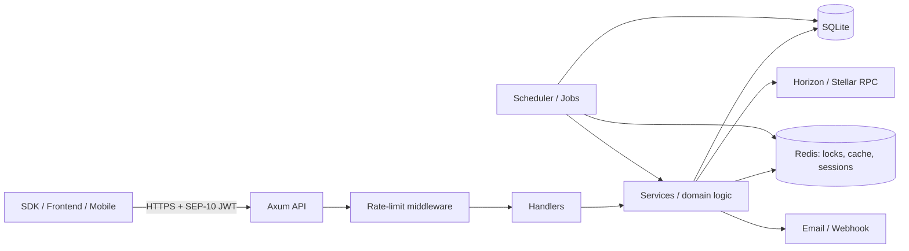
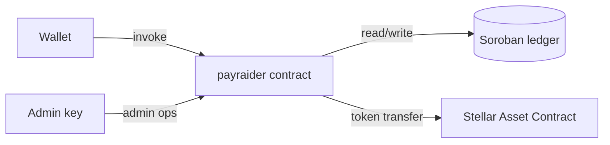
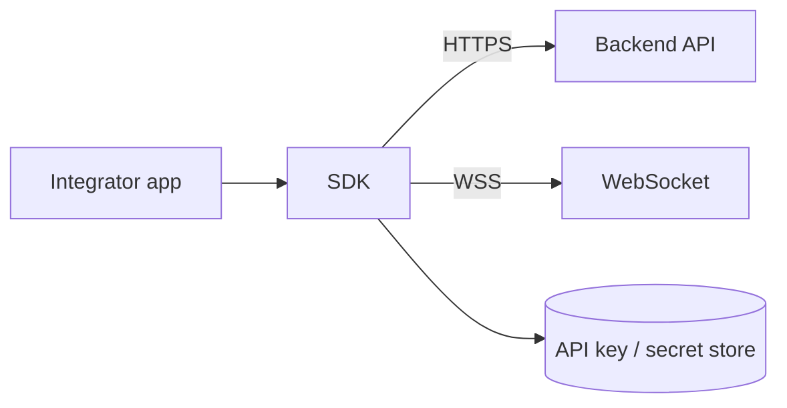
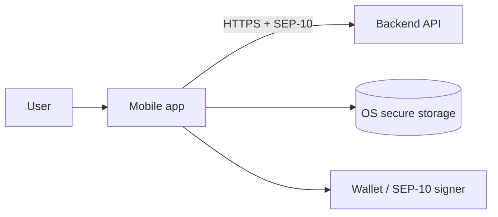

# Threat Model & Pentest-Ready Hardening Checklist

This document is the security threat model for Stellar Insights. It covers the
Rust backend, the `contracts/payraider` Soroban contract, the TypeScript and
Python SDKs, and the mobile client. It is the prerequisite for an external
penetration test / audit.

Scope: the components listed above as of the current `main`. Out of scope:
third-party infrastructure (Stellar Core/Horizon, cloud provider, email
provider) beyond how we consume it.

Methodology: [STRIDE](https://learn.microsoft.com/en-us/azure/security/develop/threat-modeling-tool-threats)
per component, with data-flow diagrams. Each threat is mapped to an existing
mitigation or a tracking issue. Gaps are called out explicitly and rolled into
the prioritised remediation list at the end.

> Tracking issues referenced below use the `#NNNN` form. Where a mitigation is
> already implemented, the relevant module is cited instead of an issue.

---

## 1. Backend (`backend/src`)

### 1.1 Data-flow diagram

### 1.2 STRIDE

| STRIDE | Threat | Mitigation / Issue |
| --- | --- | --- |
| **S**poofing | Forged SEP-10 challenge / replay of signed challenge | Server-authoritative home domain (`SEP10_HOME_DOMAIN`); challenge nonce single-use with TTL. See `backend/src/auth`. |
| **S**poofing | Stolen JWT replayed | Short-lived tokens; session IP/UA encrypted under per-user DEK. Rotation tracked in #2887. |
| **T**ampering | Client-supplied asset strings / query params | Validated at the boundary; malformed assets rejected with standard error shape. |
| **T**ampering | Stale leader writes after lease expiry | Fencing tokens enforced in storage layer (`distributed_lock`). |
| **R**epudiation | Missing audit trail for admin actions | Admin endpoints require auth; audit logging gap tracked in #2888. |
| **I**nformation disclosure | PII in logs / error bodies | Standard error shape does not echo internals; PII fields encrypted at rest. Log scrubbing gap tracked in #2889. |
| **I**nformation disclosure | Cross-tenant data access | All queries scoped by authenticated account id. |
| **D**enial of service | Request floods | Global rate-limit middleware with `RateLimit-*` + `Retry-After` headers. |
| **D**enial of service | Expensive preflight queries | Per-route limits; caching. Tuning tracked in #2890. |
| **E**levation of privilege | Missing authz on admin routes | Admin routes gated by role check. |
| **E**levation of privilege | SQL injection | `sqlx` parameterised queries only; no string-built SQL. |

---

## 2. Contract (`contracts/payraider`)

### 2.1 Data-flow diagram

### 2.2 STRIDE

| STRIDE | Threat | Mitigation / Issue |
| --- | --- | --- |
| **S**poofing | Unauthorised caller invoking privileged ops | `require_auth()` on every state-changing entry point. |
| **T**ampering | Re-initialisation / admin takeover | One-time `initialize`; re-init rejected. |
| **T**ampering | Integer overflow on amounts | Checked arithmetic (`checked_add`/`checked_mul`). |
| **R**epudiation | No on-chain event for state changes | Events emitted on every mutation. |
| **I**nformation disclosure | N/A — ledger is public by design | — |
| **D**enial of service | Unbounded loops / storage growth | Bounded iteration; storage keys namespaced. |
| **E**levation of privilege | Admin key compromise | Key rotation procedure tracked in #2891. |

---

## 3. SDKs (TypeScript / Python)

### 3.1 Data-flow diagram

### 3.2 STRIDE

| STRIDE | Threat | Mitigation / Issue |
| --- | --- | --- |
| **S**poofing | MITM on API/WS | TLS enforced; certificate validation on by default. |
| **T**ampering | Tampered response bodies | Typed parsing; malformed payloads rejected. |
| **R**epudiation | N/A (client-side) | — |
| **I**nformation disclosure | Secrets logged | SDKs never log API keys; redaction in debug logging. |
| **D**enial of service | Unbounded reconnect storms | Exponential backoff with jitter in `websocket-manager`. |
| **E**levation of privilege | N/A (no server trust boundary) | — |

---

## 4. Mobile client

### 4.1 Data-flow diagram

### 4.2 STRIDE

| STRIDE | Threat | Mitigation / Issue |
| --- | --- | --- |
| **S**poofing | Phishing / fake app | Signed builds; SEP-10 home domain pinned to backend config. |
| **T**ampering | Local storage tampering | Secrets in OS secure storage, not plain files. |
| **R**epudiation | N/A | — |
| **I**nformation disclosure | Token leakage in logs / backups | No secrets in logs; secure-storage excluded from backups. |
| **D**enial of service | N/A (client) | — |
| **E**levation of privilege | Rooted/jailbroken device | Best-effort detection; documented as residual risk. |

---

## 5. Hardening checklist

- [x] TLS everywhere (API, WS, SDK defaults)
- [x] Global rate limiting with standard headers
- [x] Parameterised SQL only (`sqlx`)
- [x] SEP-10 home domain server-authoritative
- [x] Fencing tokens for distributed writes
- [x] Contract `require_auth()` on all mutating entry points
- [x] PII encrypted at rest (per-user DEK, crypto-shred on erasure)
- [ ] Structured audit log for admin actions (#2888)
- [ ] Log scrubbing for PII (#2889)
- [ ] Per-route rate-limit tuning for expensive endpoints (#2890)
- [ ] Documented admin key rotation for contract (#2891)
- [ ] JWT rotation / revocation policy (#2887)
- [ ] Dependency scanning in CI (cargo-audit, npm audit, pip-audit) (#2892)
- [ ] Secret scanning in CI (#2893)

## 6. Known gaps

1. No structured audit trail for privileged backend actions.
2. PII may appear in unstructured logs; scrubbing not yet enforced.
3. Contract admin key rotation is undocumented.
4. No automated dependency/secret scanning in CI.
5. Mobile rooted-device detection is best-effort only.

## 7. Prioritised remediation

| Priority | Item | Issue |
| --- | --- | --- |
| P0 | Structured audit log for admin actions | #2888 |
| P0 | Dependency + secret scanning in CI | #2892, #2893 |
| P1 | PII log scrubbing | #2889 |
| P1 | JWT rotation / revocation policy | #2887 |
| P2 | Contract admin key rotation docs | #2891 |
| P2 | Per-route rate-limit tuning | #2890 |

## 8. Review

This threat model must be reviewed by two maintainers before an external audit
begins, and re-reviewed whenever a component's data flow changes.
